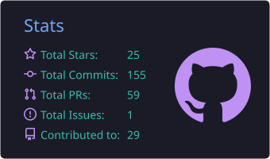
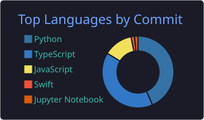

<!-- GitHub profile README for @depriver-tech. Site/developer docs live in docs/site.md -->

  
   
  
  
  
  
   
  

  
  
  

  
  
  

  <picture>
    <source media="(prefers-color-scheme: dark)" srcset="https://raw.githubusercontent.com/depriver-tech/depriver-tech/output/github-contribution-grid-snake-dark.svg" />
    
  </picture>

