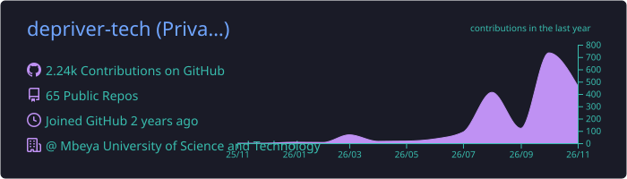
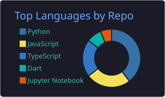
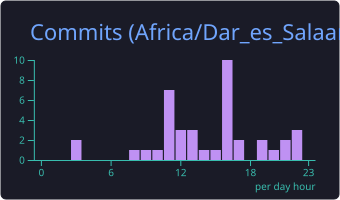

<!-- GitHub profile README for @depriver-tech. Site/developer docs live in docs/site.md -->

<p align="center">
  
</p>

<p align="center">
  <a href="https://depriver.tech">
    
  </a>
</p>

<p align="center">
  <a href="https://depriver.tech"></a>
  <a href="https://incpritech.com"></a>
  <a href="mailto:privercosmas@gmail.com"></a>
  
</p>

---

### About me

```ts
const privatus = {
  role:      "Software Engineer · Full-Stack & Mobile",
  company:   ["Rohi Company Limited", "INCPRITECH (CEO)"],
  education: "Computer Science · Mbeya University of Science and Technology",
  based:     "Mbeya, Tanzania 🇹🇿",
  building:  ["web apps", "Flutter apps", "AI tools", "business automation"],
  motto:     "Do not lose the moon while counting the shining stars.",
};
```

### Tech stack

<p align="center">
  <br/>
  
</p>

### GitHub activity

<p align="center">
  
</p>

<p align="center">
  
  
</p>

<p align="center">
  
  
  
</p>

<p align="center">
  <picture>
    <source media="(prefers-color-scheme: dark)" srcset="https://raw.githubusercontent.com/depriver-tech/depriver-tech/output/github-contribution-grid-snake-dark.svg" />
    
  </picture>
</p>

### Featured projects

| Project | What it is |
| --- | --- |
| [**incdai**](https://github.com/depriver-tech/incdai) | Public protocol, SDKs and embeddable widget for incdai, sovereign decentralized AI by INCPRITECH ([website](https://incdai.incpritech.com)) |
| [**mizuku**](https://github.com/depriver-tech/mizuku) | Open-source live wallpapers and desktop customization, a native macOS app in Swift |
| [**depriver.tech**](https://depriver.tech) | My storytelling site and blog, built with Astro, GSAP and Lenis on Cloudflare ([developer docs](docs/site.md)) |
| [**percelio**](https://github.com/depriver-tech/percelio-app) | Courier and logistics platform: Flutter mobile app plus [web](https://github.com/depriver-tech/percelio-web) |

### Let's connect

I'm open to collaborations on web, mobile and AI products. The fastest way to reach me is [privercosmas@gmail.com](mailto:privercosmas@gmail.com), or read my story at [depriver.tech](https://depriver.tech/story/).

<p align="center">
  
</p>
